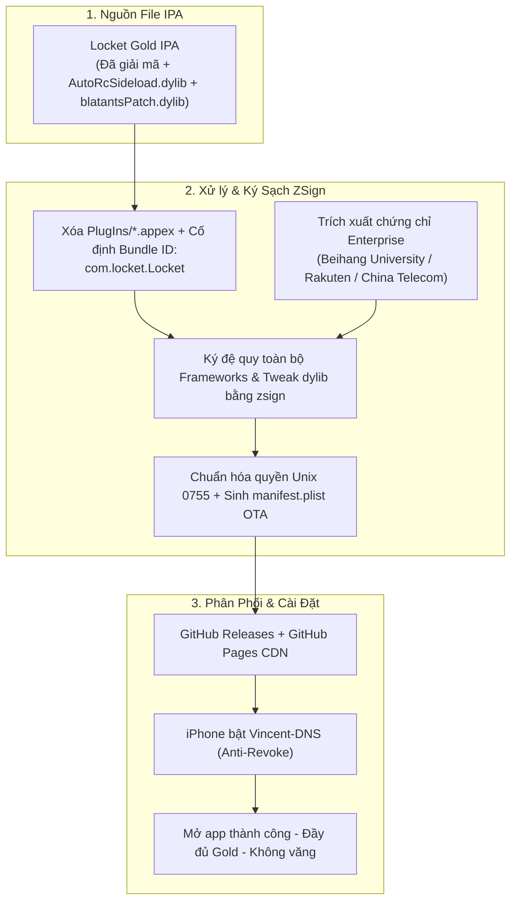

# KẾ HOẠCH TRIỂN KHAI HỆ THỐNG KÝ & CÀI ĐẶT LOCKET GOLD (IOS)
> **Thư mục dự án:** `E:\trong nhà\Game-Locket`  
> **Repository GitHub:** `https://github.com/manhcuong2112003/Locket_by_Vincent`  
> **Cổng cài đặt trực tuyến:** `https://manhcuong2112003.github.io/Locket_by_Vincent/`  
> **Trạng thái:** Đang vận hành độc lập (Tập trung 100% cho Locket Gold)

---

## 1. MỤC TIÊU DỰ ÁN
- Xây dựng cổng cài đặt trực tuyến (OTA Install Portal) chuyên biệt 100% cho **Locket Gold**.
- Khắc phục triệt để lỗi **"Văng app khi mở" (App Crash on Launch)** và lỗi **quyền thực thi Unix (`chmod 0755`)** mà không làm ảnh hưởng tới hệ thống Shadowrocket đang chạy ổn định tại `SDRK`.
- Thay thế hoàn toàn công cụ ký tự động bên thứ ba (`signtools.ipaomtk.com`) bằng **luồng tự ký chuẩn hóa trên GitHub Actions (sử dụng `zsign`)**.

---

## 2. PHÂN TÍCH NGUYÊN NHÂN CỐT LÕI (ROOT CAUSE ANALYSIS)

| Thành phần | Cơ chế cũ (Bị lỗi văng app) | Bản chất thực tế phát hiện |
| :--- | :--- | :--- |
| **Tweak Locket Gold** | Nghi ngờ file bị lỗi hoặc thiếu file mod. | File IPA gốc **đã tích hợp sẵn** `Payload/Locket.app/Frameworks/AutoRcSideload.dylib` (mở khóa Gold) và `blatantsPatch.dylib` (chống văng App Group & Keychain). |
| **Nguyên nhân văng Locket** | Nghi ngờ do iOS chặn chứng chỉ. | **Do web `signtools.ipaomtk.com` tự ý tiêm thêm `IPAOMTK-real.dylib` và đổi Bundle ID** thành `com.locket.Locket.locketwidgetipaomtkcom`, gây xung đột với `AutoRcSideload.dylib` & `blatantsPatch.dylib`. |
| **Quyền thực thi Unix (`0755`)** | Đóng gói ZIP trên Windows làm mất cờ Unix mode (`0o0`). | Chuẩn hóa bảng Central Directory ZIP với `version_made_by = 0x0314` và `external_attr = 0o100755` cho toàn bộ 16 binary/dylib. |

---

## 3. KIẾN TRÚC LUỒNG TỰ KÝ ZSIGN (SELF-HOSTED SIGNING FLOW)



---

## 4. QUY CÁCH TRIỂN KHAI CHI TIẾT CHO LOCKET GOLD (`v2.71.1`)
- **Nguồn IPA:** File IPA gốc đã tích hợp sẵn `AutoRcSideload.dylib` và `blatantsPatch.dylib`.
- **Cấu hình ký ([config_locket.json](file:///e:/trong%20nhà/Game-Locket/config_locket.json)):**
  - **Khóa cố định Bundle ID:** `com.locket.Locket`.
  - **Loại bỏ Appex:** Xóa thư mục `PlugIns/` để tránh xung đột `App Group` với chứng chỉ doanh nghiệp.
  - **Chứng chỉ ký:** `Beihang University`, `Rakuten Securities`, `China Telecom` tại `certs/`.
  - **Ký bằng `zsign`:**
    ```bash
    zsign -k cert.p12 -p AppleP12.com -m cert.mobileprovision -b com.locket.Locket -o LocketGold-beihang.ipa LocketGold-Clean-Base.ipa
    ```
