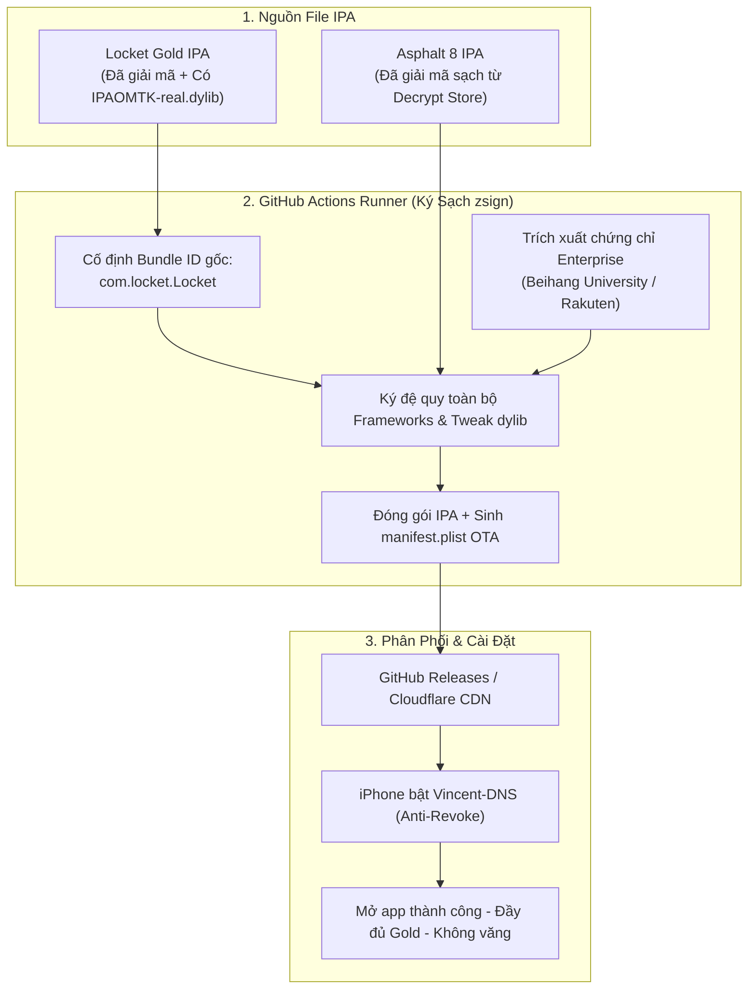

# KẾ HOẠCH TRIỂN KHAI HỆ THỐNG KÝ & CÀI ĐẶT GAME & LOCKET GOLD (IOS)
> **Thư mục dự án:** `E:\trong nhà\Game-Locket`  
> **Phiên bản tài liệu:** v1.0  
> **Trạng thái:** Sẵn sàng triển khai độc lập (Tách biệt 100% với `SDRK`)

---

## 1. MỤC TIÊU DỰ ÁN
- Xây dựng cổng cài đặt trực tuyến (OTA Install Portal) chuyên biệt cho **Locket Gold** và **Game iOS (Asphalt 8 Airborne)**.
- Khắc phục triệt để lỗi **"Văng app khi mở" (App Crash on Launch)** mà không làm ảnh hưởng tới hệ thống Shadowrocket đang chạy ổn định tại `SDRK`.
- Thay thế hoàn toàn công cụ ký tự động bên thứ ba (`signtools.ipaomtk.com`) bằng **luồng tự ký chuẩn hóa trên GitHub Actions (sử dụng `zsign`)**.

---

## 2. PHÂN TÍCH NGUYÊN NHÂN CỐT LÕI (ROOT CAUSE ANALYSIS)

Dựa trên việc kiểm tra cấu trúc gói và thực nghiệm:

| Thành phần | Cơ chế cũ (Bị lỗi văng app) | Bản chất thực tế phát hiện |
| :--- | :--- | :--- |
| **Tweak Locket Gold** | Nghi ngờ file bị lỗi hoặc thiếu file mod. | File IPA của IPAOMTK **đã tích hợp sẵn** tweak `Payload/Locket.app/IPAOMTK-real.dylib` và đã gỡ `PlugIns/*.appex`. |
| **Nguyên nhân văng Locket** | Nghi ngờ do iOS chặn chứng chỉ. | **Do web `signtools.ipaomtk.com` tự ý đổi Bundle ID** thành `com.locket.Locket.locketwidgetipaomtkcom`. Trong khi đó, `IPAOMTK-real.dylib` và Firebase được lập trình cứng chỉ nhận `com.locket.Locket` -> iOS phát hiện lệch định danh và kill app ngay khi mở. |
| **Nguyên nhân lỗi Asphalt 8** | File nặng 2.82 GB bị timeout hoặc lỗi xác minh. | Script của web IPAOMTK không ký đệ quy toàn bộ các thư viện `.framework` / `.dylib` đồ họa Metal bên trong game nặng. |
| **File từ 3uTools** | Là file gốc nguyên bản từ App Store. | File còn dính mã hóa bản quyền FairPlay DRM (`cryptid = 1`), **không thể tiêm trực tiếp tweak mod Gold** nếu chưa giải mã (decrypt) qua thiết bị Jailbreak. |

---

## 3. KIẾN TRÚC LUỒNG MỚI (SELF-HOSTED SIGNING FLOW)



---

## 4. QUY CÁCH TRIỂN KHAI CHI TIẾT THEO TỪNG ỨNG DỤNG

### 4.1. Ứng dụng Locket Gold (`v2.70.0`)
- **Nguồn IPA:** Tận dụng file IPA của IPAOMTK vì đã có sẵn thư viện bẻ khóa `IPAOMTK-real.dylib`.
- **Cấu hình ký ([config_locket.json](file:///e:/trong%20nh%C3%A0/Game-Locket/config_locket.json)):**
  - **Khóa cố định Bundle ID:** `com.locket.Locket` (Tuyệt đối không đổi tên thành `*.ipaomtkcom`).
  - **Kiểm tra loại bỏ Appex:** Đảm bảo không còn tồn tại thư mục `PlugIns/` để tránh lỗi xung đột `App Group` với chứng chỉ doanh nghiệp.
  - **Chứng chỉ ký ưu tiên:** `Beihang University` (Chứng chỉ iPhone của bạn đã bấm **Tin cậy** sẵn trong Cài đặt chung).
- **Kết quả đạt được:** Ứng dụng khởi động mượt mà, mở tính năng Locket Gold, không bị crash.

### 4.2. Game Asphalt 8 Airborne (`v9.2.0` — 2.82 GB)
- **Nguồn IPA:** File giải mã sạch từ kho game iOS đã gỡ bỏ DRM.
- **Cấu hình ký ([config_game.json](file:///e:/trong%20nh%C3%A0/Game-Locket/config_game.json)):**
  - Thực hiện ký đệ quy từng `.dylib` và `.framework` đồ họa bên trong bundle.
  - Tối ưu bộ nhớ nén zip trên GitHub Actions Runner để không bị tràn RAM khi xử lý file gần 3GB.
- **Kết quả đạt được:** Game load đầy đủ tài nguyên 3D, vượt qua kiểm tra chữ ký nhị phân của iOS.

---

## 5. LỘ TRÌNH THỰC HIỆN (ACTION PLAN)

### Bước 1: Chuẩn bị bộ công cụ ký cục bộ & CI
- Tích hợp công cụ `zsign` vào workflow GitHub Actions của `Game-Locket`.
- Chuẩn bị sẵn file chứng chỉ số Enterprise (`.p12` và `.mobileprovision` của Beihang University / Rakuten / China Telecom).

### Bước 2: Thử nghiệm ký Locket Gold với Bundle ID gốc
- Viết kịch bản tự động tải IPA Locket, ký lại bằng `zsign` với cờ:
  ```bash
  zsign -k cert.p12 -m cert.mobileprovision -b com.locket.Locket -o LocketGold_Clean.ipa Locket_Source.ipa
  ```
- Tạo file `manifest.plist` trỏ trực tiếp đến `LocketGold_Clean.ipa`.
- Cài đặt thử nghiệm trên iPhone để xác nhận app vào thẳng giao diện Gold mà không bị văng.

### Bước 3: Hoàn thiện kịch bản cho Asphalt 8
- Thiết lập quy trình nén và ký đệ quy cho file game dung lượng lớn.
- Đưa link cài đặt OTA vào giao diện web portal của `Game-Locket`.

### Bước 4: Triển khai Cổng Web độc lập
- Tạo repository riêng trên GitHub (ví dụ: `Vincent-Game-Locket`).
- Triển khai hosting riêng qua GitHub Pages hoặc Cloudflare Pages tách biệt hoàn toàn với `vincenttrick.pages.dev` của Shadowrocket.
